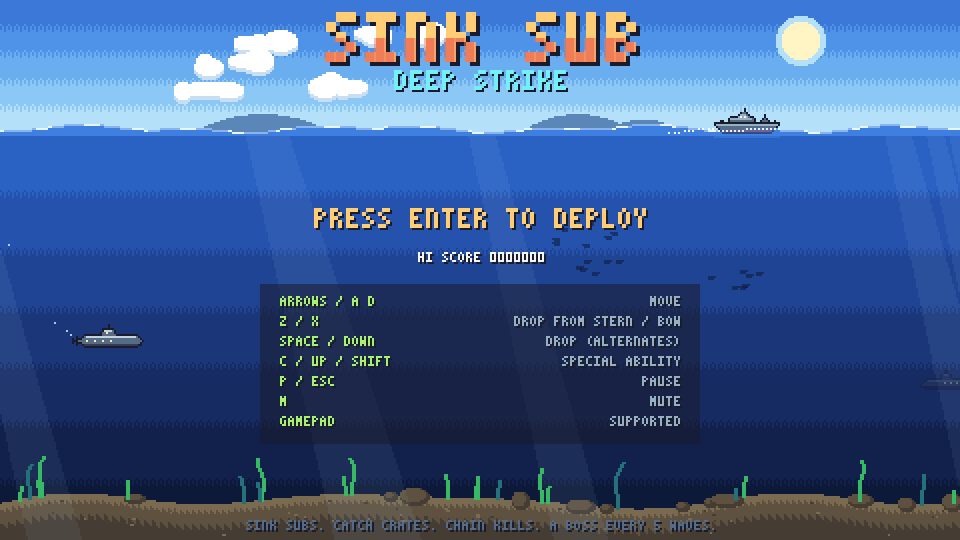
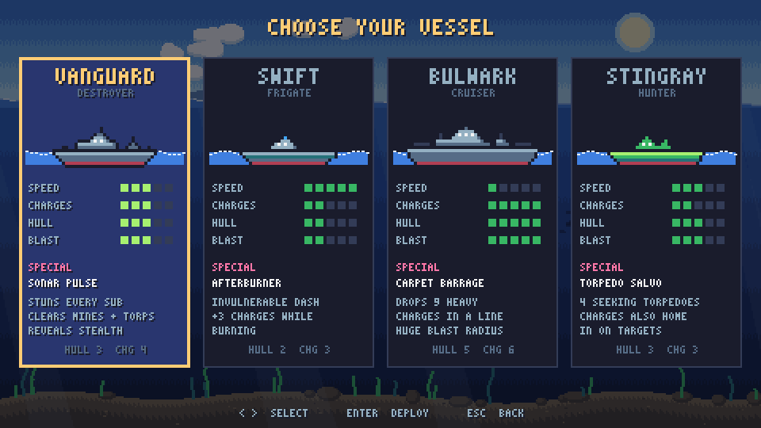
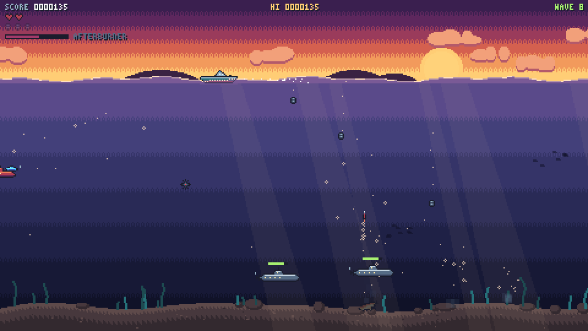
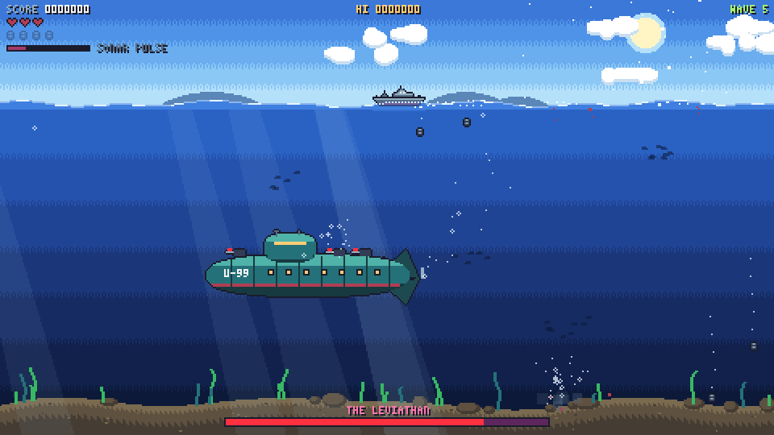
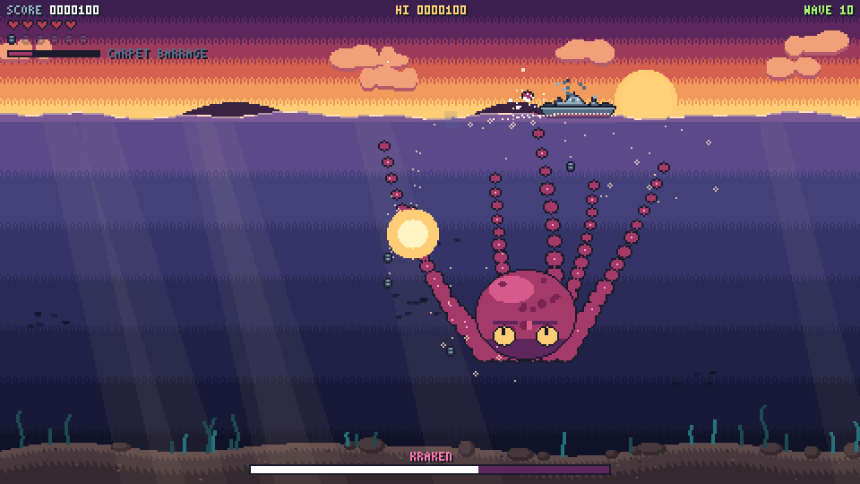
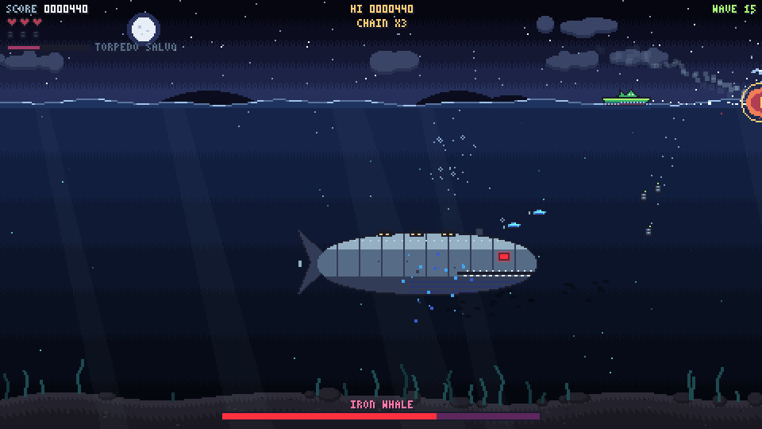
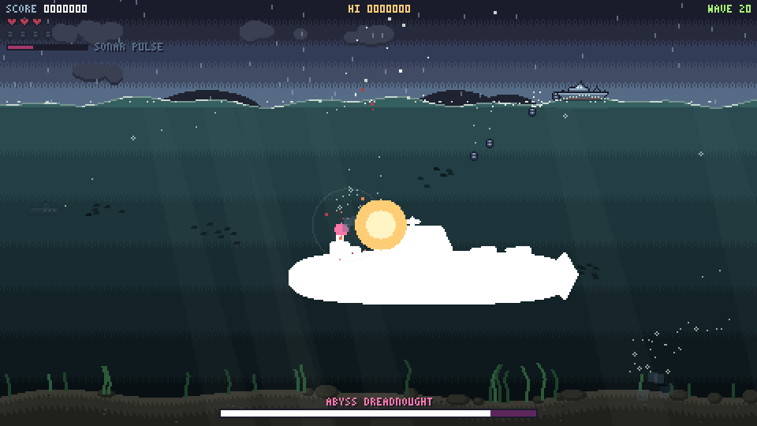
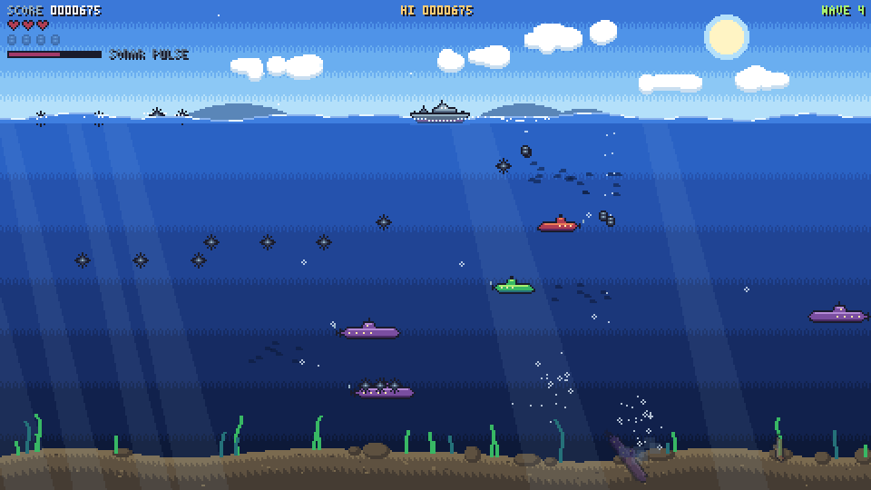

# Sink Sub: Deep Strike

A pixel-art tribute to the classic browser game **Sink Sub Pro**. You command a warship on the surface and drop depth charges on the submarines below, while dodging their mines, torpedoes and missiles. It adds selectable ships, new enemy types, boss fights, power-ups and changing weather.

It is a single HTML file with no dependencies or asset files. All sprites are pixel art drawn in code, and all sound effects and music are synthesised live with the Web Audio API.



## Play

Open `index.html` in any modern browser:

```sh
git clone https://github.com/des1-gner/sink-sub-deep-strike.git
cd sink-sub-deep-strike
open index.html        # macOS. On Linux use xdg-open, on Windows use start
```

No build step and no server needed. Audio starts after your first key press, because browsers block autoplay.

## Controls

| Key | Action |
|---|---|
| `←` `→` / `A` `D` | Move |
| `Z` / `X` | Drop a charge from the stern / bow |
| `Space` / `↓` | Drop a charge (alternates sides) |
| `C` / `↑` / `Shift` | Special ability (when the meter is full) |
| `P` / `Esc` | Pause (`Q` in the pause menu quits to the title) |
| `M` | Mute |
| `Enter` | Confirm |

A gamepad also works: left stick or d-pad to move, A to drop, LB/RB to drop from the stern/bow, Y or up for the special, Start to pause.

## Features

### Four ships



| Ship | Class | Strengths | Special |
|---|---|---|---|
| **Vanguard** | Destroyer | Balanced all-rounder | **Sonar Pulse**: stuns every sub, clears mines and torpedoes, reveals stealth subs |
| **Swift** | Frigate | Very fast, charges sink quickly, fragile | **Afterburner**: invulnerable dash plus 3 extra charges |
| **Bulwark** | Cruiser | Slow, 5 hull, 6 charges, huge blast radius | **Carpet Barrage**: drops 9 heavy charges in a line |
| **Stingray** | Hunter | Its charges steer toward targets | **Torpedo Salvo**: 4 seeking torpedoes |

The special meter fills slowly over time and faster with every kill.

### Enemies

- **Scout**: small and fast.
- **Patrol**: releases mines that float up to the surface.
- **Hunter**: fires torpedoes aimed at your ship.
- **Minelayer**: drops spreads of three mines.
- **Stealth**: nearly invisible. It shimmers when a charge gets close, and sonar reveals it.
- **Ironclad**: armoured. Its missiles leave the water and arc down at you.
- **Drone swarm**: groups of five weaving mini-subs.
- **Jellyfish**: harmless to you, but any charge that touches one fizzles out.

New enemy types arrive as the waves go on.



### Boss fights

A boss arrives every 5 waves, with a warning screen, its own music and a health bar. Each one gets harder once its health drops below half.

| | |
|---|---|
|  |  |
| **The Leviathan**: a giant U-boat. Turret torpedo volleys, launches scouts, rings of mines. | **Kraken**: tentacles burst up at your ship after a warning, and it squirts ink. It rises up from the seabed to attack, which also makes its head easier to hit. |
|  |  |
| **Iron Whale**: dives, then leaps out of the water at you. Fires missiles, sends drone swarms, makes geysers. | **Abyss Dreadnought**: lines up under you and fires a laser straight up. Torpedo fans, mine rings, summons stealth subs. |

After wave 20 the bosses come back with more health.

### Scoring and power-ups

- Kills made close together build a **chain multiplier**, up to x8.
- Deeper kills are worth more.
- Hit a mine with a charge and it explodes too, which can **chain** into nearby subs.
- Clear a wave with no subs escaping for a **perfect-wave** bonus.
- Wrecked subs sometimes drop crates that float up to the surface. Sail over one to collect it:

| Crate | Effect |
|---|---|
| `R` Repair | +1 hull |
| `T` Triple Shot | Each drop releases 3 charges |
| `M` Mega Charge | Bigger, stronger explosions |
| `F` Rapid Load | +3 charges in the water at once, faster sinking |
| `S` Shield | Blocks the next hit |
| `H` Homing | Charges steer strongly toward targets |
| `N` Nuke | Destroys everything on screen and damages the boss |
| `E` Special Ready | Fills the special meter |

Your high score is saved in the browser's local storage.

### Look and sound

- The scenery changes every 5 waves: **day**, then **sunset**, then **night** (stars and glowing plankton), then a **storm** (rain, lightning, rougher waves).
- Effects include pixel explosions with shockwave rings, screen shake, splashes, bubble trails, sinking wrecks, light rays, swaying seaweed and schools of fish.
- Sound effects and a chiptune soundtrack are generated in the browser, with separate tracks for the title screen, normal waves and bosses.



## Tech

- Plain JavaScript and an HTML5 canvas.
- The game draws at 480×270 and scales up in whole steps so the pixels stay sharp.
- The game logic runs at a fixed 60 updates per second.
- Sprites are built in code from character maps or simple shapes, with outlines, mirrored copies and white hit-flash versions made automatically.
- Text uses a custom 3×5 bitmap font.

## Credits

Inspired by *Sink Sub Pro*. This is a fan tribute and is not affiliated with the original.
